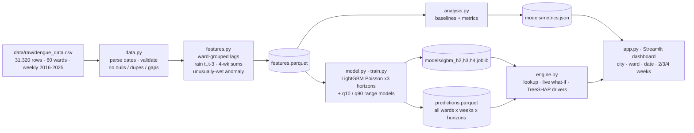

# Architecture - Urban Dengue Early-Warning System

## 1. Data flow



```
Officer input (city, ward, date, weeks ahead)
   -> date in data?  yes -> look up precomputed forecast (no model call)
                     no  -> officer enters last 4 weeks of weather -> live prediction
   -> what-if slider moved? -> rebuild the 4-week inputs -> live prediction (~25 ms)
   -> forecast + 80% range -> risk tier -> recommended action + driver chart
```

## 2. Features: the "breeding clock" without future data

For an issue week *t* every input is already known on week *t*:
rain at t, t-1, t-2, t-3; 4-week rain total; rain vs the ward's normal for that time of year
(computed from previous years only); 4-week mean humidity and temperature; cases this week and
4-week mean; season (week of year); ward traits (population density, water-logging risk, sanitation).
All lags use `groupby("ward_id").shift()` / `rolling()`, so one ward never borrows another's data.

Targets are cases at *t+2*, *t+3*, *t+4* (one model each). So the forecast for week *t+3* is driven
by rain 3-6 weeks earlier, matching the 2-4 week breeding + incubation delay. In this data, correlation
between rain and cases peaks at a 3-week delay (0.75), and the 3-week model's most important input is
"rain this week". A unit test changes all data after a date and checks features up to that date are unchanged (no leakage).

## 3. Chronological validation split

Split by the **target week**, never shuffled:

| Part | Target weeks | Rows (h=3) | Use |
|---|---|---|---|
| Train | Feb 2016 - Dec 2023 | 24,660 | fit models |
| Validation | 2024 | 3,180 | early stopping only |
| Test | 2025 | 3,120 | reported metrics, never seen in training or tuning |

## 4. Model choice

* **LightGBM, Poisson objective.** Cases are counts with many zeros (71% of weeks < 3 cases,
  variance 21 vs mean 2.6). Poisson keeps forecasts non-negative and handles the multiplicative effect
  of rain x drainage x season. Gradient boosting captures non-linear thresholds (e.g. heavy rain only matters in the monsoon).
  Trains in ~4 s per horizon on a laptop CPU.
* **Quantile LightGBM (10th / 90th percentile)** gives an 80% likely range; 2025 coverage 82-87%.
* **Drivers:** LightGBM's built-in TreeSHAP (`pred_contrib=True`), converted from the log scale to
  case units so the bars add up exactly to the forecast. No extra SHAP library.
* **Baselines on the same rows:** negative binomial GLM (statsmodels; standard for disease counts),
  same week last year, and "this week's cases". LightGBM has the lowest 2025 error at every horizon:

| Weeks ahead | LightGBM MAE | Neg. binomial | Last year | This week | High+Critical caught (LightGBM) |
|---|---|---|---|---|---|
| 2 | **1.10** | 1.90 | 1.48 | 1.73 | 63% |
| 3 | **1.13** | 1.76 | 1.48 | 1.99 | 61% |
| 4 | **1.22** | 1.80 | 1.48 | 2.16 | 51% |

* **Risk tiers** (weekly cases per ward): Low < 3 ≤ Medium < 9 ≤ High < 20 ≤ Critical
  (about 71% / 17% / 11% / 1% of historical weeks).

## 5. Compute and API cost controls

| Control | Implementation | Measured |
|---|---|---|
| Train once, serve many | `python train.py` saves models with `joblib` (compress=3) | 20.9 s total training; models 1.0-1.6 MB each |
| Load once per server | `@st.cache_resource` for models, `@st.cache_data` for tables | loaded on first visit only |
| No model call for normal use | all 31,140 ward-weeks x 3 horizons precomputed into `predictions.parquet` | 3.0 s to precompute; lookup ≈ 3 ms |
| Model runs only when needed | live prediction only for what-if changes or dates after the data | ~25 ms incl. driver breakdown |
| Small, CPU-only stack | 15 features, LightGBM on CPU, Parquet instead of Excel | 2.6 MB on disk, ≈ 8 MB in memory |
| External weather API | **none** - officers enter recent weather for new dates. If one is added: one call per city (5 cities), cached 1 hour, so ≤ 5 calls/hour regardless of users | 0 calls |
| LLM | **none** in the forecast path. Any future LLM summary must be button-triggered, `max_tokens ≤ 300`, cached per (ward, week), with a daily token budget and off by default | 0 tokens |

Timings are recorded by `train.py` in `models/metrics.json`; the "How it works" tab shows live load and forecast times.
