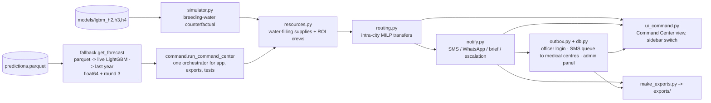

# Architecture - AlertAhead (Urban Dengue Early-Warning System)

## 1. Data flow


```
Officer input (city or all cities, ward or all wards, date, optional extra rain in the last 1-2 days)
   -> date in data?  yes -> look up the precomputed 2/3/4-week forecasts (no model call)
                     no  -> one ward: officer enters last 4 weeks of weather -> live prediction
   -> extra rain?        -> add it to this week's rain in every ward shown -> live prediction (60 wards in ms)
   -> per horizon: forecast + 80% range -> risk tier (+ watch flag if the range reaches High)
   -> one tab per lead time (2, 3, 4 weeks):
        all wards: headline, counts, per-city table, ward risk map, ranked list (CSV)
        one ward : headline, range, trend, recorded outcome (past dates), rank, drivers, rain vs cases
      each tab: action for that lead time (respond / stop breeding / plan) + its 2025 reliability
   -> all wards, each tab: ward map + team dispatch
        officer sets N teams -> top-N wards by expected cases (or cases x density x water-logging)
        officer can pin / exclude wards -> audit log + Bangla / English SMS text
        optional: live 7-day weather (display + out-of-range warning only), field notes -> Citizen Signal on map
   -> Accuracy tab: 2025 dispatch replay (AlertAhead vs even split vs perfect hindsight)
```

The field-operations layer only reads the precomputed forecasts. Live weather and field notes are shown
to the officer but never change a forecast, so the model's validated accuracy is unaffected.

## 2. Features: the "breeding clock" without future data

For an issue week *t* every input is already known on week *t*:
rain at t, t-1, t-2, t-3; 4-week rain total; rain vs the ward's normal for that time of year
(computed from previous years only); 4-week mean humidity and temperature; cases this week and
4-week mean; season (week of year); ward traits (population density, water-logging risk, sanitation).
All lags use `groupby("ward_id").shift()` / `rolling()`, so one ward never borrows another's data.

Targets are cases at *t+2*, *t+3*, *t+4* (one model each). So the forecast for week *t+3* is driven
by rain 3-6 weeks earlier, matching the 2-4 week breeding + incubation delay. In this data, correlation
between rain and cases peaks at a 3-week delay (0.75). The trained models agree (share of LightGBM gain):
the 3-week model's top input is rain this week (60%); the 2-week model leans on 4-week humidity (55%) and
4-week rain (22%); the 4-week model on season (56%) and rain this week (23%). A unit test changes all data
after a date and checks features up to that date are unchanged (no leakage).

## 3. Chronological validation split

Split by the **target week**, never shuffled:

| Part | Target weeks | Rows (h=3) | Use |
|---|---|---|---|
| Train | Feb 2016 - Dec 2023 | 24,660 | fit models |
| Validation | 2024 | 3,180 | early stopping only |
| Test | 2025 | 3,120 | reported metrics, never seen in training or tuning |

## 4. Model choice

* **LightGBM, Poisson objective.** Cases are counts with many zeros (71% of weeks < 3 cases,
  variance 21 vs mean 2.6). Poisson keeps forecasts non-negative and handles the multiplicative effect
  of rain x drainage x season. Gradient boosting captures non-linear thresholds (e.g. heavy rain only matters in the monsoon).
  Trains in ~4 s per horizon on a laptop CPU.
* **Quantile LightGBM (10th / 90th percentile)** gives an 80% likely range; 2025 coverage 82-87%.
* **Watch flag:** when the expected cases are below High but the top of the 80% range reaches High or
  Critical. On 2025 it raises the share of High/Critical weeks caught from 51-63% to 91-95%, at the cost of more false alarms.
* **Drivers:** LightGBM's built-in TreeSHAP (`pred_contrib=True`), converted from the log scale to
  case units so the bars add up exactly to the forecast. No extra SHAP library.
* **Baselines on the same rows:** negative binomial GLM (statsmodels; standard for disease counts),
  same week last year, and "this week's cases". LightGBM has the lowest 2025 error at every horizon:

| Weeks ahead | LightGBM MAE | Neg. binomial | Last year | This week | High+Critical caught (LightGBM) |
|---|---|---|---|---|---|
| 2 | **1.10** | 1.90 | 1.48 | 1.73 | 63% |
| 3 | **1.13** | 1.76 | 1.48 | 1.99 | 61% |
| 4 | **1.22** | 1.80 | 1.48 | 2.16 | 51% |

* **Risk tiers** (weekly cases per ward): Low < 3 ≤ Medium < 9 ≤ High < 20 ≤ Critical
  (about 71% / 17% / 11% / 1% of historical weeks).
* **Team dispatch:** a simple ranking, not a separate model: send N teams to the N wards with the most
  expected cases (or, in vulnerability mode, expected cases x (1 + 0.4 x density share + 0.4 x water-logging)).
  Checked on every 2025 week with recorded cases, 10 teams across 60 wards:

| Weeks ahead | Even split | AlertAhead top 10 | Perfect hindsight (ceiling) |
|---|---|---|---|
| 2 | 16.7% | **22.7%** | 30.3% |
| 3 | 16.7% | **22.3%** | 30.3% |
| 4 | 16.7% | **22.4%** | 30.3% |

  (share of all real 2025 cases that fell in the wards the teams were sent to, over 40 weeks with cases)

## 5. Compute and API cost controls

| Control | Implementation | Measured |
|---|---|---|
| Train once, serve many | `python train.py` saves models with `joblib` (compress=3) | 20.9 s total training; models 1.0-1.6 MB each |
| Load once per server | `@st.cache_resource` for models, `@st.cache_data` for tables | loaded on first visit only |
| No model call for normal use | all 31,140 ward-weeks x 3 horizons precomputed into `predictions.parquet` | 3.0 s to precompute; lookup ≈ 3 ms |
| Model runs only when needed | live prediction only for the extra-rain what-if or dates after the data; all wards in one vectorised call | ~25 ms for one ward incl. drivers |
| Small, CPU-only stack | 15 features, LightGBM on CPU, Parquet instead of Excel | 2.6 MB on disk, ≈ 8 MB in memory |
| Forecasts work offline | system fonts (incl. Bengali), banner image bundled in the repo, no CDN or tracking; forecasts, tiers, drivers and dispatch never need the internet | 0 requests for the forecast path |
| External weather API | **Open-Meteo** (free, no key), only when an officer clicks "Fetch Live 7-Day Weather". `@st.cache_data(ttl=1800)` per city is shared by all users; 3.5 s timeout; offline backup values on any failure. Display only - never feeds the model | ≤ 10 calls/hour in total (5 cities x 2) regardless of users; 0 if nobody clicks |
| Map tiles | OpenStreetMap / CARTO / Esri World Imagery, loaded by the viewer's browser only when the ward map is shown | free public tile servers; no key, no data sent about wards or patients |
| LLM | **none** in the forecast path. Any future LLM summary must be button-triggered, `max_tokens ≤ 300`, cached per (ward, week), with a daily token budget and off by default | 0 tokens |

Timings are recorded by `train.py` in `models/metrics.json`. Quality checks: 31 automated tests
(lags, leakage, split, baselines, what-if, team dispatch and overrides, 2025 dispatch backtest,
weather guardrails, field-report flags, dashboard in English and Bangla).

## 6. Deployment

* **Local:** `pip install -r requirements.txt` then `streamlit run app.py` (see README).
* **Streamlit Community Cloud:** https://edu-hackathon-26-alert-ahead-dengue-coming.streamlit.app/ -
  redeploys automatically on every push to `main`; `packages.txt` installs `libgomp1`, which LightGBM needs.
* **GitHub Codespaces:** `.devcontainer/` installs everything and starts the app on port 8501.

## 7. Phase 2 - Command Center (R1-R5)



### Data facts the design rests on
* The onsite dataset is the Phase-1 data (31,320 rows, 0 mismatches in the 12 original columns) plus
  `saline_bags_needed`, `diagnostic_kits_needed`, `hospital_beds_required`. Those are a fixed rate x same-week
  cases: least squares on 2016-2023 gives **2.384 / 1.158 / 0.2955 per case**, and round(rate x cases) reproduces
  2025 exactly (3120/3120, 3119/3120, 3120/3120). So the supplies come from the case forecast and its 80 % range;
  a separate resource model would only add error.
* There is no bed-capacity column. Capacity = each ward's **P90 weekly bed need in 2016-2023, minimum 2**
  (2-5 beds per ward, 173 in total); the officer can scale it 50-200 % (surge beds).

### R1 - constrained allocation (`dengue/resources.py`)
* **Need** = ceil(rate x planning cases). Supplies for High/Critical wards, and wards whose P90 reaches High, plan on
  the P90 upper range (safety stock); beds use the expected forecast, rounded like the dataset and the capacity
  (planning beds on P90 + ceil overflowed every ward and left nowhere to route to).
* **Stock** per city pool = stock % x base need; the safety buffer raises need only (stress test).
* **Weight** = tier weight 1 / 2 / 4 / 8 (Low -> Critical) x (1 + density / city max density).
* **Weighted water-filling**: fill_i = max(floor, min(1, lambda x w_i)), lambda by bisection so the pool is used
  exactly, floor = min(25 %, half the stock share), whole units by largest remainder. Compared on 2025 with pure
  greedy and a fixed-floor two-phase rule: same priority for Critical/High, but no ward starved and no
  "cliffs" between wards of the same tier.
* **Flags**: shortfall if fill < 100 %; red alert if a High/Critical ward is short; CODE BLACK if saline is short and
  patients still have no bed after routing.
* **Crews**: greedy on the simulator's marginal cases prevented per extra crew x (1 + density / city max); without
  the models it falls back to predicted cases x tier weight x density (deterministic).

### R2 - overflow routing (`dengue/routing.py`)
Overflow wards send patients only to wards of the same city with headroom (capacity - reserve - need), as an
integer MILP (`scipy.optimize.milp`) minimising total distance. Status bands: < 85 % normal, 85-100 % surge
(Bagust et al., BMJ 1999), > 100 % overflow. If a city still has unmet patients its pool is exhausted and a
civil-surgeon escalation is generated.

### R3 - vector-control simulator (`dengue/simulator.py`)
n crews scale the breeding-water features (rain this week and 1-3 weeks back, 4-week rain, water-logging
index) by (1 - e)^n; the 4-week anomaly is recomputed against the ward's seasonal normal; the same h2/h3/h4
LightGBM models are re-run. Baseline and counterfactual come from one live call, so 0 crews prevent exactly 0.
Prevented cases are clipped >= 0 and made non-decreasing in crews (the few non-monotone model points are
reported in the result metadata). Beds and saline prevented use the per-case rates; ROI = cases prevented per crew. Crews are auto-assigned (marginal ROI x density) or placed by the officer on selected wards (`manual_crews`, capped at the crew slider).
**Assumption:** efficacy e (default 30 %) is an officer-set parameter, not learned. The models react strongly to
rain in the monsoon (a 10 % breeding cut lowers +3-week cases by about a third on 30 Jun 2025), so the efficacy
slider should be read as an upper-bound scenario tool.

### R4 - notices (`dengue/notify.py`, `make_exports.py`)
One template engine for the app and the exports, so numbers always match. Every notice lists predicted cases,
allocated vs required supplies, the alert level and the assigned crews. English SMS fits one GSM-7 segment
(<= 160 characters), Bangla SMS <= 3 Unicode parts; WhatsApp is bilingual; the printable brief embeds a 45 KB
Noto Sans Bengali subset (OFL) so Bangla renders on any PC; no clock in any file -> byte-identical re-runs.

### Officer portal: login, alert SMS queue, admin panel (extra on R4: `dengue/ui_outbox.py`, `dengue/db.py`, `dengue/outbox.py`, `dengue/access.py`)
* **The queue** (`outbox.build_queue`): one SMS per ward with an alert, addressed to **that ward's medical centre**
  (`HC-...`), at the ward's level (CODE BLACK 1 > RED 2 > SHORTFALL 3; wards with no shortfall are not queued), plus
  an ESCALATION SMS to the **civil surgeon** (`CS-...`) of any city with a CODE BLACK ward or an exhausted bed pool.
  Most urgent first. Texts are the health-centre version of the same `notify.py` templates (English SMS <= 160
  GSM-7), so the queue, the Dispatch tab and `exports/outbox/` always agree; same scenario -> same queue. Demo
  scenario (30 Jun 2025, +3 weeks, 60 % stock): 61 SMS = 1 escalation, 1 CODE BLACK, 26 red, 33 shortfall. At low stock
  almost every ward is short, so the tab shows only ⚫ and 🔴 by default (🟠 is one click away) to avoid alert fatigue.
* **Who works it:** officers who log in. A ward officer sees their ward, a city health officer their whole city
  including the escalation, an admin (control room) everything. Medical centres need no login: they just receive the SMS.
* **Nothing is sent by the app.** The officer taps an `sms:` link that opens the phone's own SMS app with the
  centre's number and the text filled in, sends it, then marks it sent / centre confirmed. No gateway, no API key,
  no network: the kill-switch cannot break it. A real SMS gateway would be an optional add-on, never core.
* **Small database** (`dengue/db.py`): one SQLite file, `data/alertahead.db` (git-ignored; `ALERTAHEAD_DB` overrides),
  with four tables: `officers` (user name, name, role admin / city / ward, area, password hash, active),
  `contacts` (medical-centre and civil-surgeon phone numbers), `sms_status` (sent / confirmed per message) and
  `audit` (logins, failed logins, account changes, status changes). `sqlite3` ships with Python: no server, no
  internet. Short-lived connections plus a lock keep concurrent Streamlit sessions safe.
* **Login:** user name + password. Passwords are stored only as salted PBKDF2-HMAC-SHA256 hashes (200,000
  rounds) and checked with `hmac.compare_digest`; an unknown user name costs the same work as a wrong password.
  5 failed logins within 5 minutes lock that client (visitor IP when Streamlit provides it) for 5 minutes, and each
  failure waits 1 s. Disabled accounts cannot log in; officers can change their own password.
* **Admin panel:** add officers (role + ward or city; a generated password is shown once), edit, disable, reset a
  password, edit medical-centre phone numbers (validated; never in the repo), SMS log with CSV download, audit log.
  The last active admin cannot be disabled or demoted.
* **First start:** with `ADMIN_PASSWORD` in the Streamlit secrets only that admin is created; without it the portal
  runs in demo mode with three public demo accounts (admin, Dhaka North city officer, DNCC_Ward_10 ward officer)
  listed on the login screen, so judging is never blocked. R1-R5 and the Dispatch tab need no login at all.
* **Limits:** Streamlit Community Cloud's app folder is temporary, so the database resets when the app restarts or
  redeploys (accounts return to the seed); a real deployment would point `ALERTAHEAD_DB` at a persistent disk or use a
  managed database. There is no e-mail password recovery: the admin resets passwords.

### R5 - offline resilience
| Task | 1st | If unavailable | Last resort |
|---|---|---|---|
| Forecast | predictions.parquet (dates in the data) | live LightGBM from features.parquet | same week last year (2025 MAE 1.48) |
| Weather (display only) | Open-Meteo on click | offline cache | - |
| Map | tile map | tile-free map (kill-switch on) | - |
| Notices | templates (always) | - | - |

The kill-switch (sidebar toggle or `ALERTAHEAD_OFFLINE=1`) skips every optional call; the connectivity check is
lazy and cached 60 s; Streamlit telemetry is off. `tests/test_offline.py` blocks every socket and runs forecast ->
allocation -> routing -> simulator -> notices -> export with 0 network attempts, and checks the fallback ladder
with the parquet and the models removed.

### Model check (accuracy first)
Chosen on 2024 validation only, reported once on 2025:

| Lead time | Best on 2024 | 2025 MAE | Phase-1 LightGBM | Change |
|---|---|---|---|---|
| +2 weeks | ensemble of top 3 | 1.090 | 1.098 | -0.7 % |
| +3 weeks | LightGBM (tweedie) | 1.124 | 1.126 | -0.1 % |
| +4 weeks | CatBoost (depth 8) | 1.200 | 1.219 | -1.6 % |

Also tried: XGBoost, HistGradientBoosting, random forest, extra trees, Poisson GLM. No model was clearly better
(< 2 % MAE), and the +4-week CatBoost caught fewer High/Critical weeks (47 % vs 51 %), so the Phase-1 LightGBM
models stay - they also power the P90 range, the drivers and the simulator.

### Tests
95 automated tests: Phase 1 (31), contract and same-number online vs offline, allocation invariants, MILP routing,
officer portal (who is queued, who sees what, password hashing, login, admin panel, phone validation, last-admin guard, brute-force brake),
simulator (0 crews = 0, monotone, efficacy), notices (SMS limits, four required items, escalation rule,
determinism), Command Center UI smoke (AppTest), offline kill-switch and fallback ladder.
