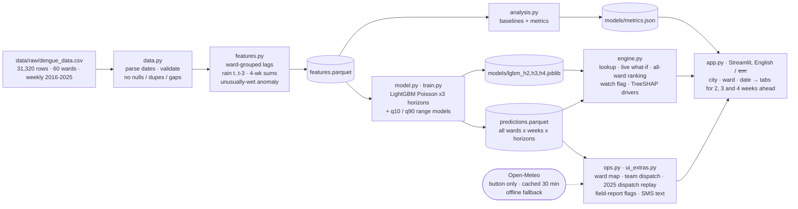

# Architecture - AlertAhead (Urban Dengue Early-Warning System)

## 1. Data flow



```
Officer input (city or all cities, ward or all wards, date, optional extra rain in the last 1-2 days)
   -> date in data?  yes -> look up the precomputed 2/3/4-week forecasts (no model call)
                     no  -> one ward: officer enters last 4 weeks of weather -> live prediction
   -> extra rain?        -> add it to this week's rain in every ward shown -> live prediction (60 wards in ms)
   -> per horizon: forecast + 80% range -> risk tier (+ watch flag if the range reaches High)
   -> one tab per lead time (2, 3, 4 weeks):
        all wards: headline, counts, per-city table, ward risk map, ranked list (CSV)
        one ward : headline, range, trend, recorded outcome (past dates), rank, drivers, rain vs cases
      each tab: action for that lead time (respond / stop breeding / plan) + its 2025 reliability
   -> all wards, each tab: ward map + team dispatch
        officer sets N teams -> top-N wards by expected cases (or cases x density x water-logging)
        officer can pin / exclude wards -> audit log + Bangla / English SMS text
        optional: live 7-day weather (display + out-of-range warning only), field notes -> Citizen Signal on map
   -> Accuracy tab: 2025 dispatch replay (AlertAhead vs even split vs perfect hindsight)
```

The field-operations layer only reads the precomputed forecasts. Live weather and field notes are shown
to the officer but never change a forecast, so the model's validated accuracy is unaffected.

## 2. Features: the "breeding clock" without future data

For an issue week *t* every input is already known on week *t*:
rain at t, t-1, t-2, t-3; 4-week rain total; rain vs the ward's normal for that time of year
(computed from previous years only); 4-week mean humidity and temperature; cases this week and
4-week mean; season (week of year); ward traits (population density, water-logging risk, sanitation).
All lags use `groupby("ward_id").shift()` / `rolling()`, so one ward never borrows another's data.

Targets are cases at *t+2*, *t+3*, *t+4* (one model each). So the forecast for week *t+3* is driven
by rain 3-6 weeks earlier, matching the 2-4 week breeding + incubation delay. In this data, correlation
between rain and cases peaks at a 3-week delay (0.75). The trained models agree (share of LightGBM gain):
the 3-week model's top input is rain this week (60%); the 2-week model leans on 4-week humidity (55%) and
4-week rain (22%); the 4-week model on season (56%) and rain this week (23%). A unit test changes all data
after a date and checks features up to that date are unchanged (no leakage).

## 3. Chronological validation split

Split by the **target week**, never shuffled:

| Part | Target weeks | Rows (h=3) | Use |
|---|---|---|---|
| Train | Feb 2016 - Dec 2023 | 24,660 | fit models |
| Validation | 2024 | 3,180 | early stopping only |
| Test | 2025 | 3,120 | reported metrics, never seen in training or tuning |

## 4. Model choice

* **LightGBM, Poisson objective.** Cases are counts with many zeros (71% of weeks < 3 cases,
  variance 21 vs mean 2.6). Poisson keeps forecasts non-negative and handles the multiplicative effect
  of rain x drainage x season. Gradient boosting captures non-linear thresholds (e.g. heavy rain only matters in the monsoon).
  Trains in ~4 s per horizon on a laptop CPU.
* **Quantile LightGBM (10th / 90th percentile)** gives an 80% likely range; 2025 coverage 82-87%.
* **Watch flag:** when the expected cases are below High but the top of the 80% range reaches High or
  Critical. On 2025 it raises the share of High/Critical weeks caught from 51-63% to 91-95%, at the cost of more false alarms.
* **Drivers:** LightGBM's built-in TreeSHAP (`pred_contrib=True`), converted from the log scale to
  case units so the bars add up exactly to the forecast. No extra SHAP library.
* **Baselines on the same rows:** negative binomial GLM (statsmodels; standard for disease counts),
  same week last year, and "this week's cases". LightGBM has the lowest 2025 error at every horizon:

| Weeks ahead | LightGBM MAE | Neg. binomial | Last year | This week | High+Critical caught (LightGBM) |
|---|---|---|---|---|---|
| 2 | **1.10** | 1.90 | 1.48 | 1.73 | 63% |
| 3 | **1.13** | 1.76 | 1.48 | 1.99 | 61% |
| 4 | **1.22** | 1.80 | 1.48 | 2.16 | 51% |

* **Risk tiers** (weekly cases per ward): Low < 3 ≤ Medium < 9 ≤ High < 20 ≤ Critical
  (about 71% / 17% / 11% / 1% of historical weeks).
* **Team dispatch:** a simple ranking, not a separate model: send N teams to the N wards with the most
  expected cases (or, in vulnerability mode, expected cases x (1 + 0.4 x density share + 0.4 x water-logging)).
  Checked on every 2025 week with recorded cases, 10 teams across 60 wards:

| Weeks ahead | Even split | AlertAhead top 10 | Perfect hindsight (ceiling) |
|---|---|---|---|
| 2 | 16.7% | **22.7%** | 30.3% |
| 3 | 16.7% | **22.3%** | 30.3% |
| 4 | 16.7% | **22.4%** | 30.3% |

  (share of all real 2025 cases that fell in the wards the teams were sent to, over 40 weeks with cases)

## 5. Compute and API cost controls

| Control | Implementation | Measured |
|---|---|---|
| Train once, serve many | `python train.py` saves models with `joblib` (compress=3) | 20.9 s total training; models 1.0-1.6 MB each |
| Load once per server | `@st.cache_resource` for models, `@st.cache_data` for tables | loaded on first visit only |
| No model call for normal use | all 31,140 ward-weeks x 3 horizons precomputed into `predictions.parquet` | 3.0 s to precompute; lookup ≈ 3 ms |
| Model runs only when needed | live prediction only for the extra-rain what-if or dates after the data; all wards in one vectorised call | ~25 ms for one ward incl. drivers |
| Small, CPU-only stack | 15 features, LightGBM on CPU, Parquet instead of Excel | 2.6 MB on disk, ≈ 8 MB in memory |
| Forecasts work offline | system fonts (incl. Bengali), banner image bundled in the repo, no CDN or tracking; forecasts, tiers, drivers and dispatch never need the internet | 0 requests for the forecast path |
| External weather API | **Open-Meteo** (free, no key), only when an officer clicks "Fetch Live 7-Day Weather". `@st.cache_data(ttl=1800)` per city is shared by all users; 3.5 s timeout; offline backup values on any failure. Display only - never feeds the model | ≤ 10 calls/hour in total (5 cities x 2) regardless of users; 0 if nobody clicks |
| Map tiles | OpenStreetMap / CARTO / Esri World Imagery, loaded by the viewer's browser only when the ward map is shown | free public tile servers; no key, no data sent about wards or patients |
| LLM | **none** in the forecast path. Any future LLM summary must be button-triggered, `max_tokens ≤ 300`, cached per (ward, week), with a daily token budget and off by default | 0 tokens |

Timings are recorded by `train.py` in `models/metrics.json`. Quality checks: 31 automated tests
(lags, leakage, split, baselines, what-if, team dispatch and overrides, 2025 dispatch backtest,
weather guardrails, field-report flags, dashboard in English and Bangla).

## 6. Deployment

* **Local:** `pip install -r requirements.txt` then `streamlit run app.py` (see README).
* **Streamlit Community Cloud:** https://edu-hackathon-26-alert-ahead-dengue-coming.streamlit.app/ -
  redeploys automatically on every push to `main`; `packages.txt` installs `libgomp1`, which LightGBM needs.
* **GitHub Codespaces:** `.devcontainer/` installs everything and starts the app on port 8501.
